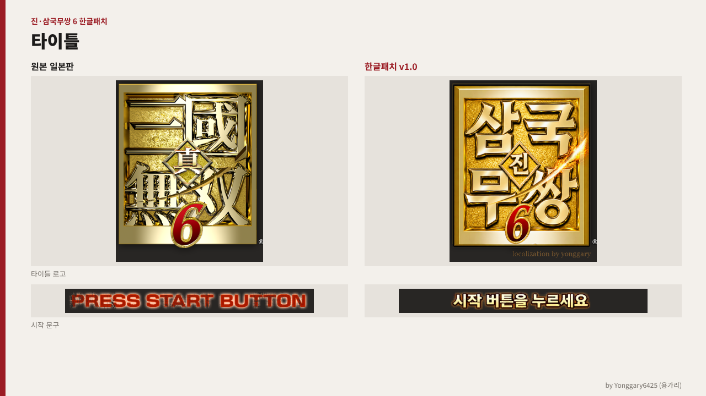
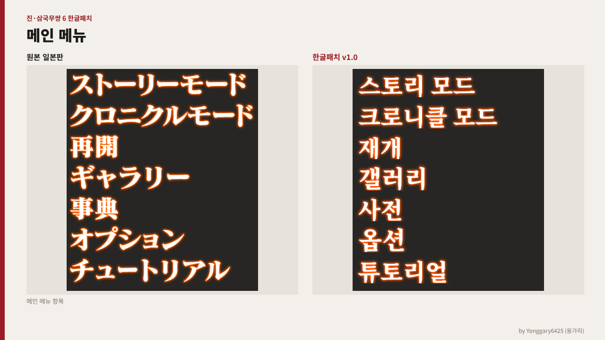
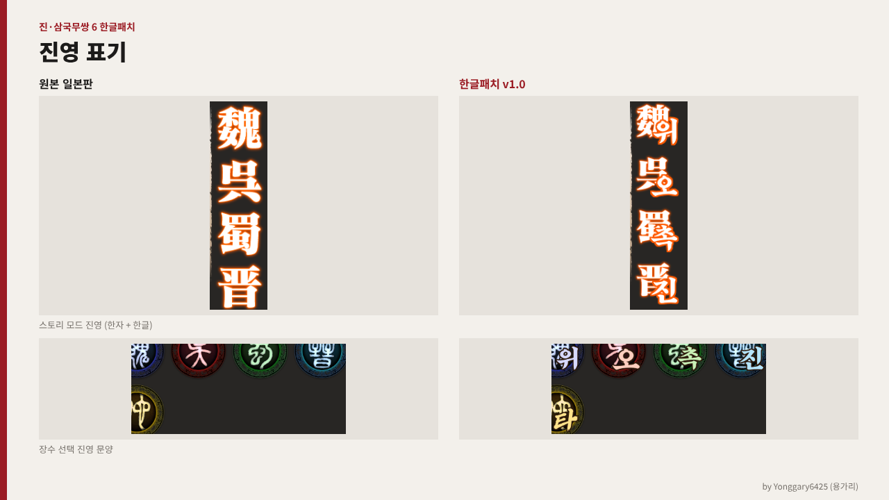
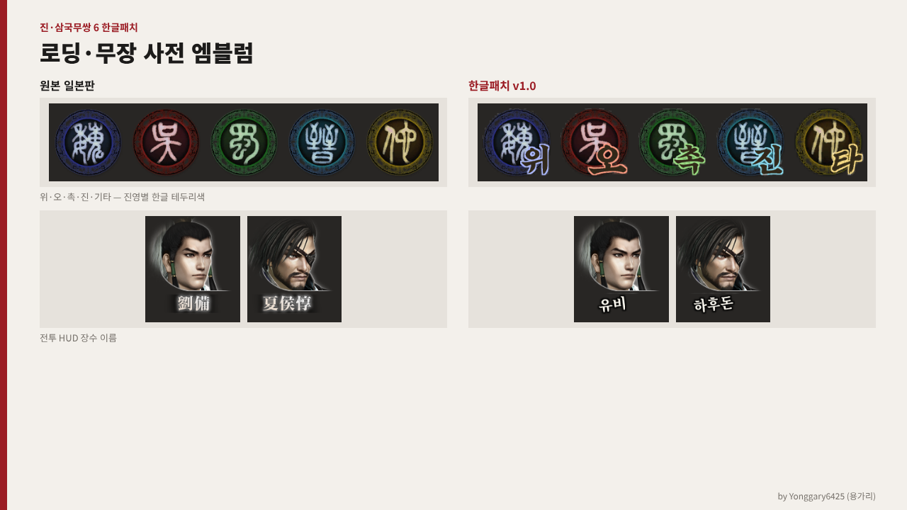
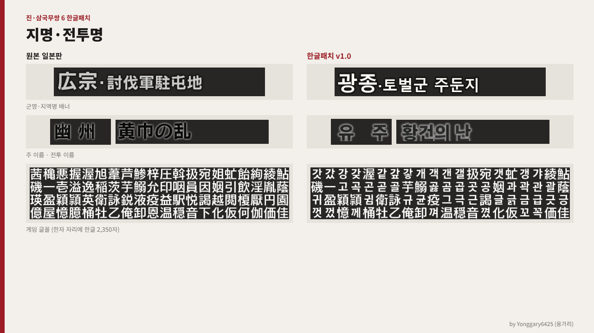

# 진·삼국무쌍 6 (真・三國無双6) 한글패치 (PS3)

**진·삼국무쌍 6** PS3 일본판(**BLJM60291**)을 한글로 즐길 수 있는 비공식 한글패치입니다.

> 본 한글패치는 개인이 제작한 비공식·비상업적 팬 한글패치입니다. — by **Yonggary6425 (용가리)**
> 게임 파일(ISO)은 포함되어 있지 않습니다. 직접 소유한 원본으로만 사용해 주세요.

---

## 원본과 비교

왼쪽이 원본 일본판, 오른쪽이 한글패치입니다. (게임 데이터에서 꺼낸 그림입니다.)

**타이틀**



**메인 메뉴**



**진영 표기**



**로딩·무장 사전 엠블럼, 전투 HUD**



**지명·전투명·글꼴**



## 한글화 범위

- 메뉴·대사·전투 메시지·장수 열전·사전·로딩 장수 소개 등 **텍스트 전반** (문자열 40,177곳)
- **한글 글꼴 2,350자**: 게임 글꼴의 한자 자리에 한글을 그려 넣음
- **타이틀 로고**와 시작 문구, 메인·스토리·옵션·갤러리 **메뉴 이미지**
- 장수 선택 이름, **전투 HUD 장수명 65개**, 군영·지역명 이미지 47개
- **진영 표기**(위·오·촉·진)는 원본 한자에 한글을 겹쳐 표시
- 전투 로딩·무장 사전 **진영 엠블럼** — 진영별 한글 테두리색 (위 청보라 · 오 붉은색 · 촉 녹색 · 진 하늘색 · 기타 금색)
- 사전 지도 **지역 표기 301개**, XMB 게임 제목·아이콘, 저장·불러오기 시스템 안내

## 준비물

- **진·삼국무쌍 6** PS3 일본판 / **BLJM60291** — 게임 폴더(`PS3_GAME` 폴더가 있는 형태) 또는 ISO
  - 패처가 게임 파일(LINKDATA.IDX)을 검사해서 맞는 판본일 때만 적용됩니다.
  - ISO는 복호화된 ISO와 암호화된 ISO(Redump 등) 모두 됩니다. 암호화된 ISO는 같은 폴더에 같은 이름의 `.dkey` 파일이 있어야 합니다.
- Windows 10/11 (추가 설치 필요 없음)
- RPCS3

## 다운로드

[Releases](../../releases)에서 `SSM6_KOR_Patch_v1.0_xdelta.zip`(17.9 MB)을 받습니다.

이 패처는 한글 데이터 자체가 아니라 **원본과의 차이(xdelta)**만 담고 있습니다. 사용자의 원본 게임 데이터에서 한글 데이터를 만들어 낸 뒤 하나하나 해시로 확인하고 적용합니다.
그래서 반드시 손대지 않은 일본판 원본이 필요합니다. 다른 한글패치가 덮어쓴 파일이 있으면 「원본이 아닙니다」라고 나오며 중단됩니다.

## 적용 방법

1. 게임과 RPCS3를 완전히 종료합니다.
2. 압축을 풀고, 아래 중 편한 방법으로 `한글패치_적용.bat`을 실행합니다.
   - 게임 폴더나 ISO 파일을 `한글패치_적용.bat` 위에 **끌어다 놓기**
   - 패치 폴더를 게임 폴더(`PS3_GAME` 폴더가 있는 곳) 안에 넣고 더블클릭
   - 그냥 더블클릭한 뒤, 게임 폴더나 ISO 파일을 검은 창에 끌어다 놓고 Enter (아무것도 없이 Enter를 누르면 폴더 선택 창이 뜹니다)
3. 패처가 PC에서 **RPCS3 폴더를 자동으로 찾아** 보여 줍니다. 맞으면 Enter를 누르세요.
   - 예전에 이 게임을 실행했다면 RPCS3에 옛 데이터 사본(캐시)이 남아 있어, 이걸 정리하지 않으면 일부 그림·글자가 예전 그대로 나옵니다. 패처가 정리해 줍니다.
   - 못 찾으면 `rpcs3.exe`가 있는 폴더 경로를 직접 입력하세요.
4. 「한글패치 적용 완료!」가 뜨면 끝입니다.

### ISO로 패치할 때

- 원본 ISO는 그대로 두고, 같은 폴더에 `원래이름_KOR.iso`를 새로 만듭니다. 새 ISO로 게임을 실행하세요.
- 암호화된 ISO를 넣으면 새 ISO는 복호화된 ISO로 만들어지므로 `.dkey` 없이 바로 실행됩니다.
- 원본 ISO 크기만큼의 여유 공간이 더 필요하며, 만드는 데 몇 분 걸립니다.
- 한글패치를 지우려면 `_KOR.iso` 파일만 삭제하면 됩니다.

### 제거 (폴더 패치)

- `한글패치_제거.bat`을 같은 방법으로 실행하면 원본 상태로 돌아갑니다.
- 게임 폴더에 생기는 `_hanpatch_backup_BLJM60291` 폴더는 원본 백업이므로 지우지 마세요.

### 동작 방식 (폴더 패치)

- LINKDATA.BIN 원본 내용은 건드리지 않고 끝에 한글 데이터를 덧붙인 뒤 LINKDATA.IDX가 그쪽을 가리키게 합니다. (하드디스크 여유 공간 600MB 정도 필요)
- 다시 실행해도 원본 기준으로 새로 적용되므로 여러 번 실행해도 안전합니다. 예전 버전으로 패치한 게임에도 그대로 다시 실행하면 됩니다.
- 교체 파일: EBOOT.BIN, PARAM.SFO(XMB 게임 제목), ICON0/PIC0/PIC2.PNG — 교체 전 원본은 백업 폴더에 보관합니다.

## 알려진 사항

- 영상에 직접 그려진 글자, 배경 장식 한자, 일본어 음성은 원본 그대로입니다.
- 수정된 EBOOT.BIN은 RPCS3용(복호화된 ELF)입니다. **PS3 실기에서는 동작을 보장하지 않습니다.** PS3 실기에서는 테스트하지 않았으므로 **실기 관련 문의에는 답변드리기 어렵습니다.**
- 모든 분기를 실제 플레이로 검수한 완전판은 아닙니다. 오역·잘림을 발견하면 [Issues](../../issues)로 알려 주세요.

## 구성

```
screenshots/   원본/한글패치 비교 그림
patcher-src/   패처 스크립트 (PowerShell), bat, 읽어보기
README.md / RELEASE_NOTES.md / NOTICE.md
```

패처는 원본 게임 데이터를 검사하는 PowerShell 스크립트(`hanpatch.ps1`), xdelta 차이 데이터, `xdelta3.exe`로 이루어져 있습니다. 차이 데이터는 Releases의 zip에 들어 있습니다.

## 크레딧

- 한글화·패처 제작: **Yonggary6425 (용가리)**
- 패처에 포함된 `xdelta3.exe`: xdelta 3.1.0 (© Joshua P. MacDonald, Apache License 2.0)
- 원작: 真・三國無双6 © コーエーテクモゲームス (KOEI TECMO GAMES). 모든 권리는 원저작권자에게 있습니다.

## 버그 제보

오역·오탈자·표시 문제는 [Issues](../../issues)에 어느 모드·장면인지와 스크린샷을 함께 올려 주세요.
